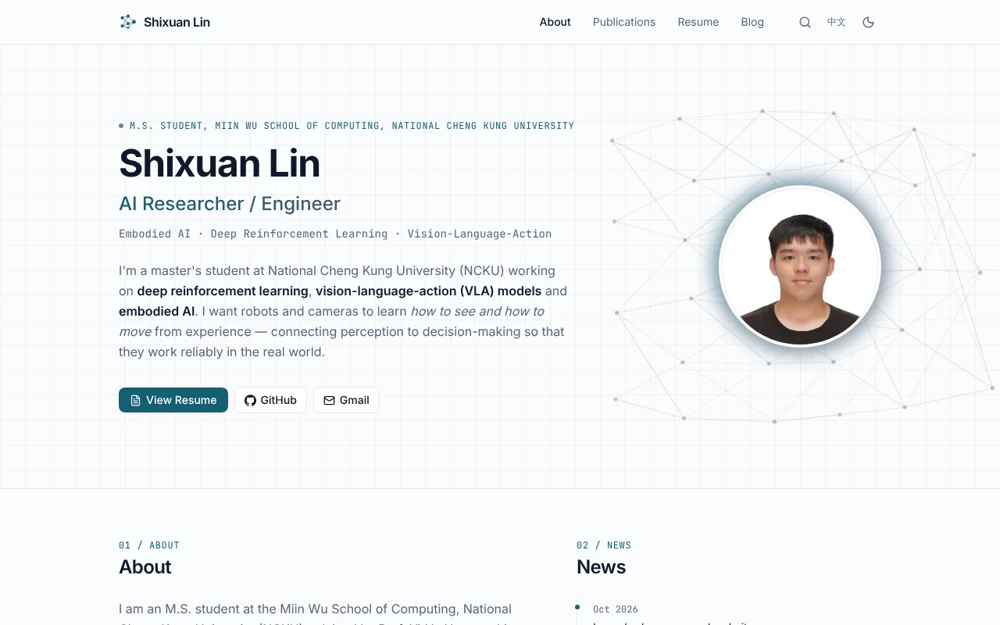

# Shixuan Lin — Personal Website

Source code for **[shixuanlin1009.github.io](https://shixuanlin1009.github.io)**, the personal website of Shixuan Lin (林世璿), an M.S. student at the Miin Wu School of Computing, National Cheng Kung University, working on embodied active tracking with deep reinforcement learning.



## What's on the site

- **Research and projects:** detail pages for active PTZ camera tracking (SARC-PTZ), volleyball video captioning (VolleyCC), RECOBOT and more, with figures and demo videos
- **Publications:** papers with status, abstracts and BibTeX
- **Resume:** a web version and PDFs in English and Chinese, generated from the same data as the site
- **Blog:** notes on papers, books and ideas, synced from an Obsidian vault
- **Certificates:** competitions, certifications and activities, each with its scanned certificate

The whole site is bilingual: English at `/`, Traditional Chinese at `/zh/`.

## Built with

| | |
| --- | --- |
| Framework | [Astro 7](https://astro.build), TypeScript |
| Styling | [Tailwind CSS v4](https://tailwindcss.com) |
| Content editing | [Sveltia CMS](https://github.com/sveltia/sveltia-cms) at `/admin`, plus Obsidian sync for the blog |
| Resume PDF | [Typst](https://typst.app), rendered from the site's `/cv/<locale>.json` |
| Search | [Pagefind](https://pagefind.app) |
| Markdown extras | KaTeX math, Mermaid diagrams, callouts, YouTube / video embeds |
| Hosting | GitHub Pages, deployed by GitHub Actions on every push to `main` |

## Run it locally

Requires **Node.js 24** (at least 22.23.4).

```bash
npm ci
npm run dev      # http://localhost:4321
```

| Command | What it does |
| --- | --- |
| `npm run dev` | Start the dev server |
| `npm run check` | Type-check |
| `npm run build` | Full build: site, resume PDFs (needs `typst` 0.15.1) and search index |
| `npm run build:site` | Build the site only, without the PDFs |
| `npm run preview` | Serve `dist/` (search works only here and in production) |

## Project structure

```
src/content/        All site content (Markdown and YAML), one file per item
  showcase/en|zh-TW/  Research, projects, competitions, certificates, activities
  blog/               Blog posts synced from Obsidian
  singletons/         Profile, social links, site settings, resume layout
src/views/          Page templates shared by both languages
src/plugins/        Markdown plugins (embeds, highlights, comments)
public/admin/       CMS configuration
resume/             Typst resume template
scripts/            Obsidian sync, resume PDF and publish scripts
docs/               Maintainer guide (Chinese)
```

The maintainer guide, covering the CMS, Obsidian publishing and the resume PDF, is in [docs/README.md](docs/README.md) (Traditional Chinese).

## Reuse

The site's text, photos, figures and certificates are © Shixuan Lin. Please ask before reusing them. If you want to build a similar site, feel free to read the code for ideas.

## Contact

Email [james920402@gmail.com](mailto:james920402@gmail.com), or visit the [website](https://shixuanlin1009.github.io).
